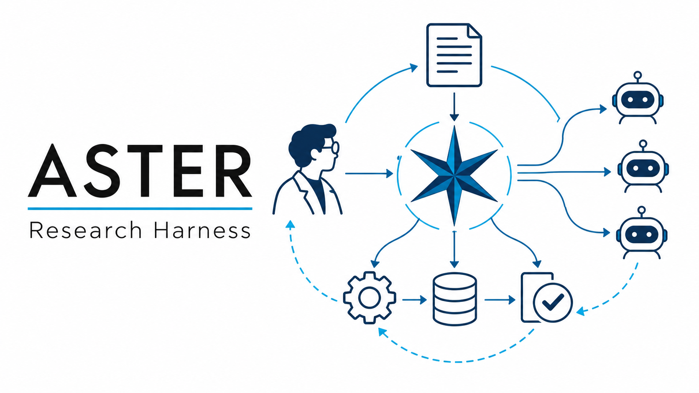
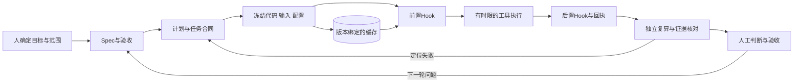

<p align="center"></p>

# Aster Research Harness · 星研

**把研究问题接到可执行任务，把每个结论接回真实证据。**

Aster 是本团队围绕科研长任务设计的项目层 Agent Harness。它以 Codex 等执行宿主为基础，将 Spec、任务合同、冻结快照、Hook、缓存、分工验收与研究循环组织成一套可追溯的工作方式。名字取自星形花与星状连接，寓意多个任务围绕共同目标协作。

本仓库是课程项目的脱敏、可移植发布版：保留实际使用的 Spec 管理工具，提供从项目执行设施整理而来的独立任务运行器、核验器、模板和合成数据示例。MDD-EEG 是应用案例。医学原始数据、模型权重、患者预测和服务器凭据不在本仓库中。

## 五分钟运行

需要 Python 3.10+，核心运行器与 Spec 工具仅使用标准库。

```bash
python aster_harness.py --help
python -m unittest discover -s tests -v
python aster_harness.py freeze examples/task.json runs/demo
python aster_harness.py run runs/demo
python aster_harness.py review runs/demo
```

任务示例的准确命令与字段见 [快速开始](docs/quickstart.md)。示例概率来自合成数据，只展示工程闭环。

## 一条完整执行链



## 组件与边界

|组件|发布内容|状态|
|---|---|---|
|Spec|需求结构检查、证据SHA、JSON条件、派生状态|可运行，摘自项目工具|
|任务执行|代码与输入快照、无shell命令、时限、退出与输出回执|可运行的可移植实现|
|Hook|执行前核对冻结资产，执行后核对退出与产物|运行器内显式调用|
|资产复用标识|输入、代码与配置绑定，任务防重复执行|可运行；跨任务自动缓存查找由使用者接入|
|结果核验|合成逐人概率的混淆矩阵、BA、AUC、灵敏度、特异度|可运行示例；真实模型冷重放依模型另接|
|多Agent|规划、执行、核验的责任与交接模板|工作协议；不内置模型调度服务|
|Goal / Plan / Loop|目标边界、下一步、内外环及停止条件|模板；由宿主和人驱动|
|Skill / 插件 / MCP|能力选择与连接约定|集成说明；使用宿主现有能力|

## 团队设计的贡献

我们的设计落在项目层：将需求验收与实验退出分开，绑定输入与模型资产，区分执行者和核验者，按证据恢复任务，并将核验发现反馈到下一轮实验。框架的原创性指这套面向科研任务的组织、实现与集成，不指 Codex、MCP、基础模型或通用 Agent 概念由我们发明。

## 科研使用原则

- 按人或实验单位划分数据，评价规则在执行前固定。
- 记录失败与未知资格，配置错误不能解释为模型阴性。
- 程序能核对文件和显式条件；科学解释与最终接受由相应证据和研究者决定。
- 示例与历史研究结果分别标记，不将软件测试通过等同于模型有效。

详见 [架构](docs/architecture.md)、[验证与适用范围](docs/verification.md) 和 [开源归属](NOTICE.md)。
